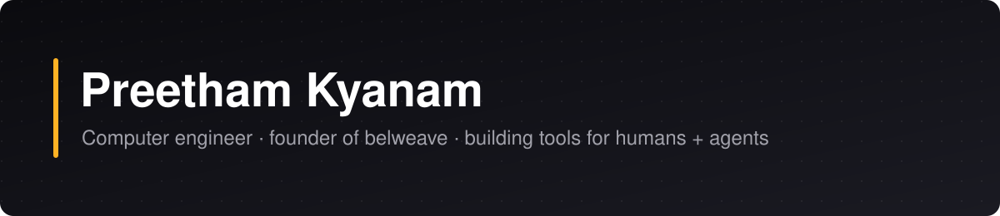

I'm a computer engineer and the founder of **belweave**. I build developer tools, agent infrastructure and native apps — from Arduino libraries and Raspberry Pi operating systems to iOS clients for coding agents.

### Stack

         

### Featured projects

<table>
<tr>
<td colspan="2" width="100%" valign="top">
<a href="https://github.com/pkyanam/ArduRoomba"><b>ArduRoomba</b></a>  
Modular Arduino library for iRobot Roomba Open Interface, with Uno, Mega, ESP32, ESP8266, Wi-Fi, and BLE support.
</td>
</tr>
<tr>
<td width="50%" valign="top">
<a href="https://github.com/pkyanam/omarchy-4-pi"><b>omarchy-4-pi</b></a>  
Omarchy Quattro for Raspberry Pi 4 Model B (4GB+ RAM): flashable ARM64 images, Pi-aware updates, and agent-friendly workflows.
</td>
<td width="50%" valign="top">
<a href="https://github.com/pkyanam/halo-ce-apple-silicon"><b>halo-ce-apple-silicon</b></a>  
Experimental Apple Silicon native Halo source build tooling; bring your own supported Xbox disc image.
</td>
</tr>
<tr>
<td width="50%" valign="top">
<a href="https://github.com/pkyanam/WumpaForge"><b>WumpaForge</b></a>  
Native ARM64 Wrath of Cortex research and compatibility runtime. Bring your own Xbox game image.
</td>
<td width="50%" valign="top">
<a href="https://github.com/pkyanam/graphbrain"><b>graphbrain</b></a>  
Multi-tenant AI-agent memory with isolated HelixDB knowledge graphs, hybrid retrieval, and MCP access.
</td>
</tr>
<tr>
<td width="50%" valign="top">
<a href="https://github.com/pkyanam/tisplay"><b>tisplay</b></a>  
View and control a computer's primary desktop from a terminal, including over SSH.
</td>
<td width="50%" valign="top">
<a href="https://github.com/pkyanam/tallyhand"><b>tallyhand</b></a>  
Local-first, self-hostable time tracking and invoicing for contractors, with a web app, CLI, and agent-friendly API.
</td>
</tr>
<tr>
<td width="50%" valign="top">
<a href="https://github.com/pkyanam/opencode-bot"><b>opencode-bot</b></a>  
Persistent OpenCode-powered bots with a shared computer, live browser, and Telegram. Self-hosted on Cloudflare.
</td>
<td width="50%" valign="top">
<a href="https://github.com/pkyanam/pk"><b>pk</b></a>  
pk is a terminal coding workspace.
</td>
</tr>
<tr>
<td width="50%" valign="top">
<a href="https://github.com/pkyanam/agentcalc"><b>agentcalc</b></a>  
A lightweight, agent-native calculator CLI: expressions, exact arithmetic, statistics, units, matrices, and Python/Node adapters. MIT licensed.
</td>
<td width="50%" valign="top">
<a href="https://github.com/pkyanam/openlaunch"><b>openlaunch</b></a>  
Agent-agnostic device bridge for Arduino Uno R4 WiFi and Raspberry Pi, with scoped capabilities and MCP integration.
</td>
</tr>
</table>

### GitHub activity

<picture><source media="(prefers-color-scheme: dark)" srcset="https://github-readme-stats.vercel.app/api?username=pkyanam&show_icons=true&hide_border=true&disable_animations=true&theme=github_dark"/></picture>
<picture><source media="(prefers-color-scheme: dark)" srcset="https://github-readme-stats.vercel.app/api/top-langs/?username=pkyanam&layout=compact&hide_border=true&disable_animations=true&theme=github_dark"/></picture>

<picture><source media="(prefers-color-scheme: dark)" srcset="https://streak-stats.demolab.com?user=pkyanam&hide_border=true&disable_animations=true&theme=dark&background=0D1117&ring=FFB224&fire=FFB224&currStreakLabel=FFB224"/></picture>

